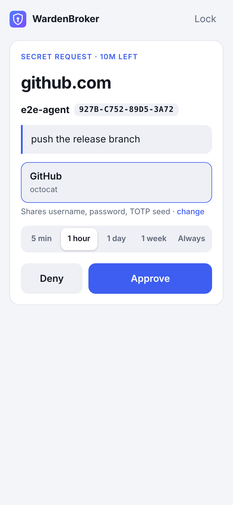

# WardenBroker

**Let your self-hosted agents use your Bitwarden vault — one tap on your phone at a time.**

An agent asks for a secret by host and says why. Your phone buzzes. You see who's asking, for what and why. WardenBroker has
already found the matching Bitwarden item. You approve it for 5 minutes, an hour, a day, a week or for good, and the secret is
encrypted on your phone straight to that agent's key. The broker in the middle only ever relays ciphertext.

```
agent$ wardenbroker get github.com --reason "push the release branch"
Waiting for approval of github.com on your phone…
gh-pass-123
```

<p align="center"></p>

- **Your vault stays end-to-end encrypted.** The master password, the vault key and decrypted items never leave your phone.
  The broker stores agent public keys, encrypted grants and an activity log.
- **Bitwarden is the source of truth.** Works with bitwarden.com, bitwarden.eu, Vaultwarden and NodeWarden. There's no
  second vault to keep in sync.
- **One tap, with a passkey.** After the first sign-in, a passkey (Face ID / fingerprint) both signs you in and decrypts the
  vault key on the device, using the WebAuthn PRF extension.
- **The UI is two screens.** When something needs you, you see that one thing. Otherwise you see your agents and what they did.
- **Runs entirely on the Cloudflare Workers Free plan.** One Worker, one SQLite Durable Object and static assets. Every
  request stays well under the 10 ms CPU limit.

## How it works

```
 ┌──────────┐  1. get github.com     ┌────────────────┐   2. push "agent needs github.com"   ┌────────────────────┐
 │  Agent   │ ─────────────────────▶ │  WardenBroker  │ ───────────────────────────────────▶ │  Your phone (PWA)  │
 │  (CLI)   │   (long-polls ≤25 s)   │  (CF Worker +  │                                      │  - Bitwarden vault │
 │ P-256 key│                        │ Durable Object)│ ◀─────────────────────────────────── │    decrypted here  │
 │          │ ◀───────────────────── │ ciphertext only│   3. item sealed to the agent's key  │  - passkey unlock  │
 └──────────┘  4. decrypt locally    └────────────────┘                                      └────────────────────┘
```

1. **Agent registration.** `wardenbroker register` generates a P-256 key pair on the agent's machine. The private key never
   leaves it. You get a notification showing the agent's name and key fingerprint. Compare the fingerprint with the
   terminal, then tap *Connect*.
2. **Secret request.** `wardenbroker get <host> --reason "<why>"` asks the broker. If a grant you approved earlier is still
   active, the broker answers immediately with the stored ciphertext. Otherwise it notifies you and holds the request open
   (a long poll), so the agent gets the answer the moment you tap.
3. **Approval.** The PWA matches the host against your vault, using Bitwarden's own URI match rules. It picks the item
   automatically when exactly one fits best, and lets you search otherwise. It then encrypts the item to the agent's
   public key: ECIES with P-256, HKDF-SHA256 and AES-256-GCM, bound to the host. Payment cards are the exception:
   `wardenbroker card` names no host, and you always pick which card to share.
4. **Delivery.** The broker passes the ciphertext to the waiting agent and keeps it as a *grant* for the duration you
   chose. Until the grant expires or you revoke it, that agent's requests for that host are answered without asking you.

### Security model

| Party | Sees |
| --- | --- |
| Your phone | Everything. It is the only place your vault is decrypted. |
| Broker (Cloudflare) | Agent names and public keys, hosts, reasons, item *names*, timestamps, and ciphertext only an agent can open. In transit it also proxies Bitwarden login traffic: the KDF-derived password *hash*, tokens, and the encrypted vault. |
| Agent | The items you approved for it, in plaintext. |

- **Plaintext goes to the agent.** That is the point, and the spec accepts it. Agents are trusted to use secrets
  responsibly. Prefer `wardenbroker run`, which puts secrets in a child process's environment, over `get`, which prints
  them. Use Zero Data Retention or provider-side redaction where you can.
- **The broker can't decrypt anything it stores.** Every grant is sealed to one agent's key and bound to one host, so the
  broker can't replay a `github.com` secret as the answer for `evil.com`.
- **Trust in the web app.** As with any web vault, whoever controls the Worker deployment controls the JavaScript your
  phone runs. Deploy it to your own Cloudflare account.
- **What a passkey stores.** The phone keeps the 64-byte Bitwarden user key and a refresh token in `localStorage`,
  AES-GCM-encrypted with a key derived from the passkey's PRF output. Without the passkey (and its Face ID / PIN check),
  that blob is useless. The master password is never stored.
- **Broker sessions.** The broker accepts two kinds of login: a Bitwarden password login for `OWNER_EMAIL`, which
  Bitwarden itself verifies, including 2FA; or a passkey you registered from such a session. Sessions last 12 hours, in an
  `HttpOnly; Secure; SameSite=Strict` cookie. Mutations also require a same-origin `Origin` header.
- **Agent tokens** are random 256-bit bearer tokens. The broker stores only their SHA-256 hash. On the agent side they
  live with the private key in a `0600` file.

## Setup

You need a Cloudflare account (the Free plan is enough) and Node 22+.

```bash
git clone https://github.com/MeLlamoPablo/WardenBroker && cd WardenBroker
npm install
```

Edit `wrangler.jsonc`:

```jsonc
"vars": {
  "OWNER_EMAIL": "you@example.com",           // your Bitwarden account email
  "BW_SERVER": "https://vault.bitwarden.com"  // or https://vault.bitwarden.eu, or your Vaultwarden/NodeWarden URL
}
```

Deploy:

```bash
npm run deploy
```

On your phone, open the `*.workers.dev` URL (or your custom domain) and **add it to your home screen**. WardenBroker only
runs as an installed app; it needs that for push notifications on iOS. Open it, sign in with your Bitwarden email and master
password, create a passkey and enable notifications.

Optional variables: `BW_IDENTITY_URL` / `BW_API_URL` (for unusual server layouts) and `VAPID_SUBJECT` (defaults to
`mailto:OWNER_EMAIL`). The VAPID keys for push are generated on first use and stored in the Durable Object.

**Passkey requirements.** Vault unlock needs the WebAuthn PRF extension: iOS/iPadOS 18+ with iCloud Keychain, Android with
Google Password Manager, recent Chrome/Edge/Safari on desktop, and most password-manager passkeys. Without PRF, WardenBroker
still works: you unlock with your master password each time.

## The agent CLI

Install the prebuilt binary (Linux and macOS, x86-64 and ARM) into `~/.local/bin`:

```bash
curl -fsSL https://raw.githubusercontent.com/MeLlamoPablo/WardenBroker/master/install.sh | sh
```

The script verifies the binary against the release's `SHA256SUMS`. Re-run it to update; set `WARDENBROKER_VERSION=v0.1.0`
to pin a release or `WARDENBROKER_INSTALL_DIR` to install elsewhere. Windows binaries, and every other build, are on the
[releases page](https://github.com/MeLlamoPablo/WardenBroker/releases). With Go 1.24+ you can also build it yourself:

```bash
go install github.com/MeLlamoPablo/WardenBroker/cli/cmd/wardenbroker@latest
```

**Releasing:** bump `cli/VERSION` on `master`. CI tests and builds every platform, then publishes the `vX.Y.Z` release
and a `cli/vX.Y.Z` tag, so `go install …@latest` resolves to it too.

```bash
wardenbroker register --url https://wardenbroker.you.workers.dev --name "build-box"
wardenbroker get github.com --reason "push the release branch"           # prints the password
wardenbroker get github.com --field totp --reason "log in"               # current TOTP code
wardenbroker get api.openai.com --field "API Key" --reason "run evals"   # a custom field
wardenbroker get db.internal --json --reason "inspect the item"         # whole item as JSON
wardenbroker card --field cvv --reason "pay order #1234 (17.99 EUR) at shop.example"   # you pick the card
wardenbroker run --reason "deploy" -e GITHUB_TOKEN=github.com -e PGPASSWORD=db.internal -- ./deploy.sh
wardenbroker run --reason "pay order #1234" -e NUMBER=@card -e EXPIRY=@card:expiry -e CVV=@card:cvv -- ./pay.sh
wardenbroker status
wardenbroker forget
```

- `--field`: `password` (the default; falls back to the item's only custom field when there's no password), `username`,
  `totp`, `totp-seed`, `notes`, `uri`, or any custom field name.
- **Cards** aren't tied to a website, so `wardenbroker card` sends no host. Your phone lists every card in the vault and
  never picks one for you. Card fields: `number` (the default), `cardholder`, `brand`, `expiry` (`MM/YY`), `exp-month`,
  `exp-year` and `cvv`. In `run`, use `@card` where the host would go.
- `run` requests every host in parallel, so they all reach your phone together. It then runs the command with the secrets
  in its environment and passes the command's exit code through.
- Exit codes: `0` ok, `1` error, `2` usage, `3` denied/revoked, `4` timed out/expired. Messages go to stderr, values to
  stdout.
- The key and token live in `~/.config/wardenbroker/agent.json` (`0600`). Override the location with `WARDENBROKER_CONFIG`.

For coding agents (Claude Code, Codex, …), [`skills/wardenbroker/SKILL.md`](skills/wardenbroker/SKILL.md) tells them how to
ask for secrets well: one host, a specific reason, and `run` rather than `get`.

## Cloudflare Free plan

- **CPU.** Each request does a few SQLite queries and at most a few native WebCrypto operations. The unit suite benchmarks
  the heaviest paths: an uncached VAPID signature plus RFC 8291 encryption takes about 1.2 ms per push, and verifying a
  passkey assertion takes about 0.4 ms.
- **Holding the agent's request open.** The spec asked whether the broker can do this within the CPU limit. It can: the
  limit counts CPU time, not wall time, and a request waiting on a promise uses none. The Durable Object parks
  `GET /api/agent/requests/:id?wait=25` for up to 25 s and wakes it when you answer. The CLI loops until the request is
  resolved. Waiting does consume Durable Object *duration*: the Free plan's 13,000 GB-s/day covers roughly 28 hours of
  continuous waiting per day.
- **Static assets** (the PWA) are served by Workers Assets and don't count as Worker invocations.

## Development

```bash
npm run dev            # builds the PWA and runs wrangler dev on http://localhost:8787
npm run dev:web        # Vite dev server for UI work (proxies /api to :8787)
npm run typecheck
npm test               # unit tests + Go tests + the end-to-end suite
```

On `localhost` the PWA also runs in a normal browser tab, so you can develop without installing it.

### Tests

`npm run test:e2e` starts the real Worker under `wrangler dev`, a mock Bitwarden server and Chromium. The mock uses genuine
Bitwarden crypto: a PBKDF2 master key, a protected user key, per-item keys and an RSA-wrapped organisation key. Chromium has
a virtual passkey authenticator with PRF. The suite drives the real PWA and the real Go CLI through 29 steps: 2FA login,
passkey setup, agent registration with a decrypted push notification, auto-matched and ambiguous approvals, custom fields,
org items, host-less card requests, grants and revocation, lock/unlock, refresh-token rotation, the master-password fallback, security boundaries,
and a scan of the broker's on-disk state for any plaintext secret.

`E2E_SCREENSHOTS=/some/dir` saves screenshots along the way. `E2E_HEADED=1` shows the browser.

See [DECISIONS.md](DECISIONS.md) for the design decisions behind all of this.
